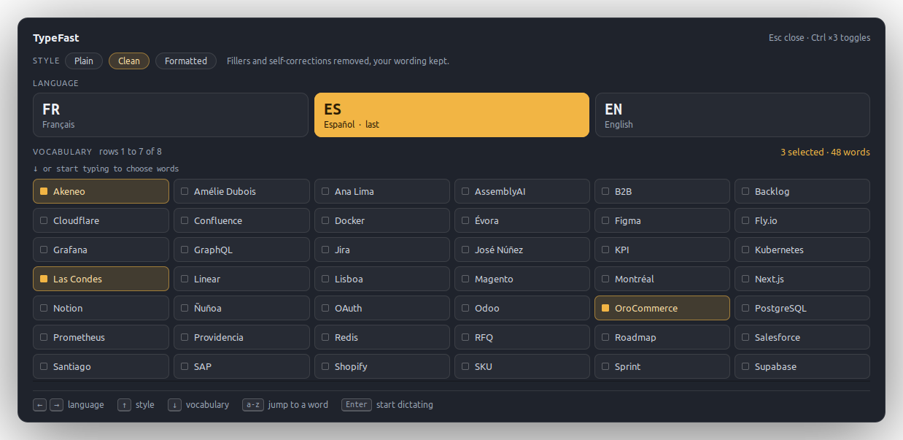
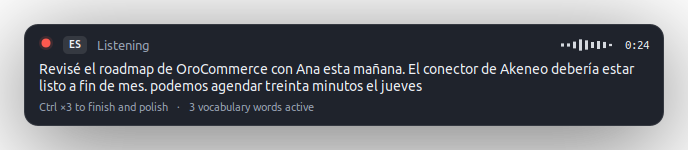
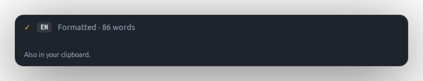
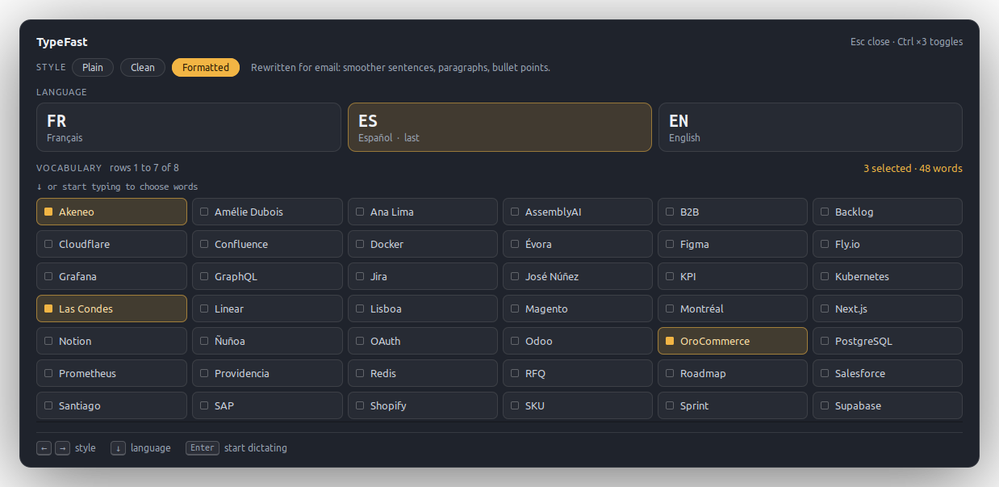
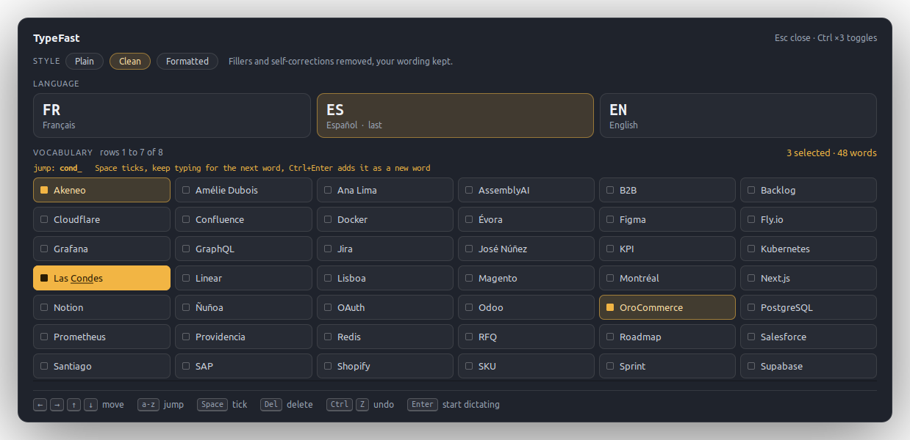
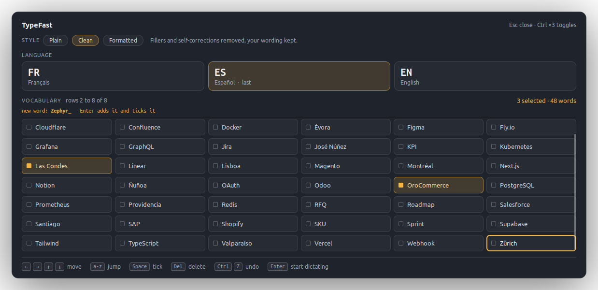
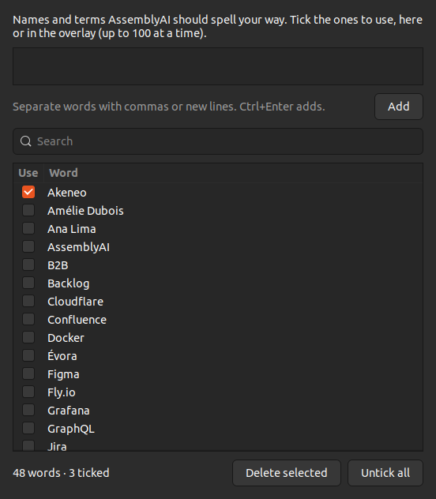
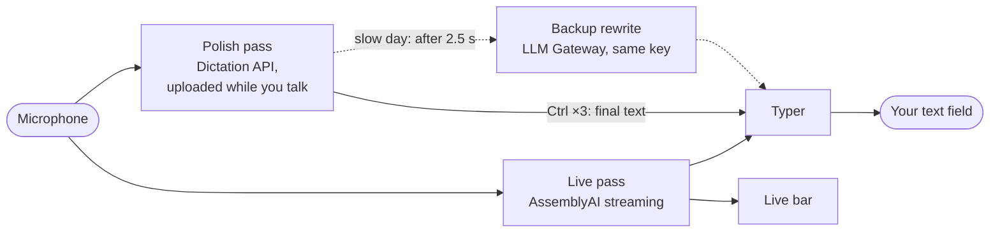
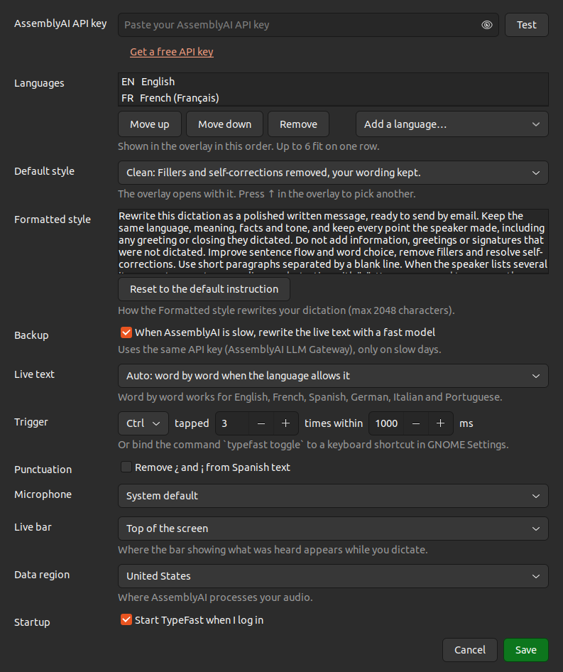

<div align="center">

# TypeFast

**Dictate anywhere on Ubuntu. See your words appear as you speak, then get a polished version a second later.**

[](LICENSE)




</div>

Tap **Ctrl three times**, pick a language, and talk. TypeFast types your words live
into whatever field has your cursor: Gmail, Slack, a terminal, a form, anything.
Tap Ctrl three times again and the live text is replaced by a clean transcript,
with your fillers gone, your self-corrections resolved and your own names and
terms spelled right. Need an email rather than a chat message? Pick the
**Formatted** style and get paragraphs and bullet points.

It is free and open source. Transcription runs on [AssemblyAI](https://www.assemblyai.com)
with your own API key (new accounts come with free credit).

## Highlights

- **Keyboard only, under a second to start.** Triple-tap Ctrl, press Enter, talk.
- **You always see what was heard.** Words land in your field as you speak, and a
  small bar at the top of the screen mirrors the live transcript.
- **A polished final pass.** The audio is uploaded while you talk, so the clean
  version is usually ready about a second after you stop, even for long dictations.
- **Three styles.** Plain, Clean (the default) or Formatted for emails.
- **Your vocabulary.** Product names, people, places: tick them before dictating,
  add or delete them right from the overlay.
- **32 languages**, with a quick-pick row for the ones you use.
- **Safe with your text.** TypeFast only ever replaces what it typed itself, and
  steps back the moment you touch the keyboard or mouse.

## How it works

**1. Tap Ctrl three times.** The overlay opens over whatever you are doing, without
stealing the focus from your app, so your cursor stays where it was. The last language
you used is already selected: press **Enter** and start talking.

**2. Talk.** Words are typed into the focused field as you say them, and each sentence
gets its punctuation when you pause. The bar at the top of the screen shows what was
heard; clicks go straight through it.



**3. Tap Ctrl three times again.** The live text is swapped for the polished version.
Only what TypeFast typed is replaced: anything that was already in the field stays.



### Keys in the overlay

| Key | What it does |
| --- | --- |
| `←` `→` | Pick the language (or the style, on the style row) |
| `↑` | Go up to the style row |
| `↓` | Go down to the languages, then into the vocabulary grid |
| `a`-`z` | Jump to the first matching word in the grid |
| `Space` | Tick or untick the focused word |
| `Enter` | Start dictating (or add the word you just typed, see below) |
| `Del` | Delete the focused word, `Ctrl`+`Z` brings it back |
| `Esc` | Clear the typed letters, then close |

### Styles

Most of the time the default is what you want, so the style row sits above the
languages and the overlay always opens on **Clean**. Press `↑` when you need another.



| Style | What you get | Example, from *"so um I checked the roadmap with Ana this morning, uh, can we meet Thursday, no, Friday?"* |
| --- | --- | --- |
| **Plain** | Your words as transcribed, with punctuation and your vocabulary. No rewriting. | So, um, I checked the roadmap with Ana this morning. Uh, can we meet Thursday, no, Friday? |
| **Clean** | Fillers and self-corrections removed, your wording kept. | So I checked the roadmap with Ana this morning. Can we meet Friday? |
| **Formatted** | Rewritten for email: smoother sentences, paragraphs, bullet points for lists. | I checked the roadmap with Ana this morning.<br><br>Could we meet on Friday? |

The Formatted instruction is plain English and you can rewrite it in Settings.
Formatted text is pasted rather than typed (a typed Enter would send a chat message),
and it stays in your clipboard afterwards.

### Vocabulary

Names and terms AssemblyAI should spell your way. Tick the ones that matter for
this dictation (up to 100) and they are sent along with the audio.



Type a few letters to jump to a word: `cond` lands on *Las Condes*. Type a word that is
not there yet and press **Enter** to add it, already ticked; `Ctrl`+`Enter` adds it even
when it matches an existing word, and `Space` lets you type multi-word terms.



For bigger edits, the tray menu opens a vocabulary window where you can paste whole
lists, search, rename and tick words.



## Under the hood



- **Live pass.** Universal-Streaming Multilingual gives word-by-word partials in English,
  French, Spanish, German, Italian and Portuguese; other languages use Universal-3.6 Pro,
  which rewrites the current sentence about once a second.
- **Polish pass.** The same audio streams to AssemblyAI's Dictation API in segments of
  up to two minutes, cut at pauses, so only the last stretch is still processing when you
  stop. It returns both a verbatim transcript and a cleaned one.
- **Deadline and backup.** If the Dictation API has not answered after 2.5 seconds, the
  live text goes to a fast model through AssemblyAI's LLM Gateway, and whichever answer
  comes first wins. After 10 seconds (25 for Formatted) TypeFast keeps the live text; a
  polished version that arrives later goes to **Recent dictations** in the tray menu.
  Tapping Ctrl three times while it polishes keeps the live text right away.
- **Typing.** Keys go through XTEST using only your active keyboard layout; characters
  that layout lacks (an `é` on a Spanish keyboard, say) are put on a spare key once.
  Before every key, TypeFast checks that you are not holding Ctrl, Alt or Shift, so an
  injected letter never turns into a shortcut.
- **Safety.** TypeFast edits only text it typed. If you click, type or switch windows
  while dictating, it stops touching the field and puts the final text on the clipboard.

More detail, and the reasoning behind each choice, in [docs/DESIGN.md](docs/DESIGN.md).

## Requirements

- **Ubuntu 22.04 or newer.** Other GNOME distributions work if they show tray icons,
  for example with the "AppIndicator and KStatusNotifierItem Support" extension.
- **An X11 session.** On the login screen, click the gear icon and choose
  **Ubuntu on Xorg**. Wayland does not let apps listen to the keyboard globally or type
  into other windows, so TypeFast cannot work there yet.
- **A microphone** and an internet connection.
- **An AssemblyAI API key**, free at
  [assemblyai.com/dashboard/api-keys](https://www.assemblyai.com/dashboard/api-keys).

## Install

```bash
git clone https://github.com/turtlesfr/typefast.git
cd typefast
./install.sh
```

The installer adds the few system packages it needs (it asks for your password only if
some are missing), creates a Python environment inside the folder, adds a `typefast`
command and an app launcher, and starts TypeFast at login. Use
`./install.sh --no-autostart` to skip the login item.

On first launch, Settings opens: paste your AssemblyAI key, press **Test**, then **Save**.

## Settings

Click the microphone icon in the top bar, then **Settings…**



- **API key**, with a Test button.
- **Languages** shown in the overlay, in your order (32 available).
- **Default style** and the instruction the **Formatted** style follows.
- **Backup** rewrite when AssemblyAI is slow (same key, only used on slow days).
- **Live text** model, **trigger** (Ctrl, Shift or Alt, 2 to 5 taps), **microphone**,
  position of the **live bar** (top or bottom), **data region** (US or EU), start at login,
  and an option to drop `¿` and `¡` from Spanish text.

Prefer a regular shortcut? Bind `typefast toggle` in
**Settings > Keyboard > Custom Shortcuts**. Other commands: `typefast settings`,
`typefast vocabulary`, `typefast quit`, `typefast --debug`.

## Cost and privacy

Audio goes to AssemblyAI for the live pass and again for the final pass. At October 2026
prices that is roughly $0.15 to $0.45 per hour for the live pass plus $0.62 per hour for
the final pass, so about $1 per hour of actual dictation; the backup rewrite costs a
fraction of a cent when it runs. Check [AssemblyAI pricing](https://www.assemblyai.com/pricing)
for current numbers.

Your API key, vocabulary and history stay on your computer, in `~/.config/typefast/` and
`~/.local/share/typefast/`, readable only by you. TypeFast talks to nothing but
AssemblyAI. Pick the EU data region in Settings to keep processing in the European Union.

## Troubleshooting

- **No tray icon:** on GNOME outside Ubuntu, enable the AppIndicator extension.
- **Ctrl taps do nothing:** check that you are on X11 (`echo $XDG_SESSION_TYPE` prints
  `x11`), then run `typefast --debug` in a terminal and watch the log.
- **The polished text takes long:** AssemblyAI's latency varies; TypeFast never waits
  more than 10 seconds and tells you when it kept the live text.
- **A character came out wrong:** open an issue with your layout (`setxkbmap -query`) and
  the text that went wrong.
- **Logs:** `~/.local/share/typefast/typefast.log`.

## Uninstall

```bash
./uninstall.sh          # keeps your settings and vocabulary
./uninstall.sh --purge  # removes them too
```

## Development

```bash
.venv/bin/pip install -e ".[dev]"
.venv/bin/python -m pytest
```

The unit tests cover the tap detector, the overlay keys, vocabulary rules, text edits,
styles and the polish logic against a fake API. A few scripts exercise the parts that
need a real X session or the real API:

| Script | What it checks |
| --- | --- |
| `scripts/render_previews.py` | Renders every screenshot in `docs/screenshots` without opening a window. |
| `scripts/typer_check.py` | Live typing, corrections, a held Ctrl, typed and pasted swaps, in a throwaway window. |
| `scripts/paste_check.py` | The paste path against an app that reads the clipboard late, like Chrome on Gmail. |
| `scripts/chrome_paste_check.py` | The same in a real Chrome (temporary profile), checked through DevTools. |
| `scripts/e2e_pipeline.py` | A 16 kHz mono PCM file through the live and polish passes with your key. |

Project layout:

| Path | Role |
| --- | --- |
| `typefast/app.py` | State machine, tray, settings and sessions |
| `typefast/overlay.py`, `overlay_model.py` | The overlay and its keyboard logic |
| `typefast/session.py`, `streaming.py`, `polish.py`, `rewrite.py` | Live pass, polish pass, backup |
| `typefast/injector.py`, `xkeys.py`, `clipboard.py` | Typing and pasting into other apps |
| `typefast/x11.py`, `taps.py` | Global key listener and the triple-tap detector |
| `typefast/hud.py`, `windows.py`, `tray.py` | Live bar, settings and vocabulary windows, tray menu |

## Credits

Speech recognition, the Dictation API and the LLM Gateway by
[AssemblyAI](https://www.assemblyai.com). Built with GTK 3, python-xlib, httpx,
websockets and sounddevice.

## License

[MIT](LICENSE)
